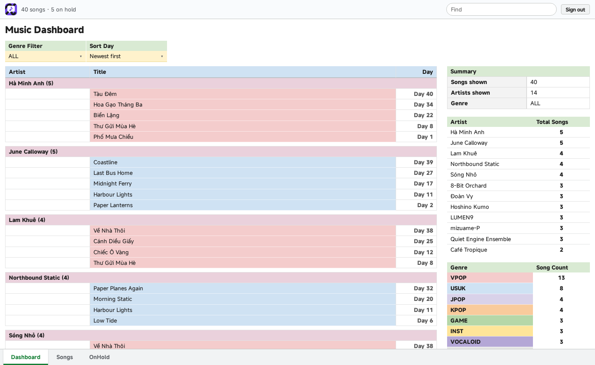
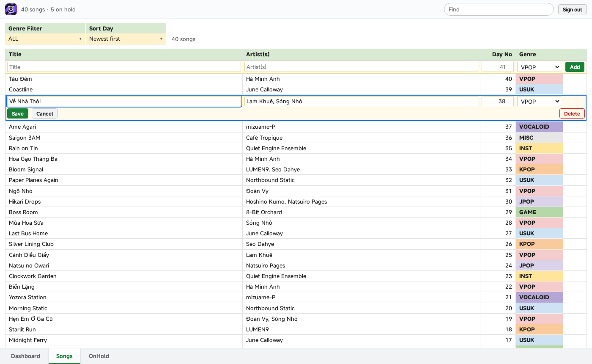
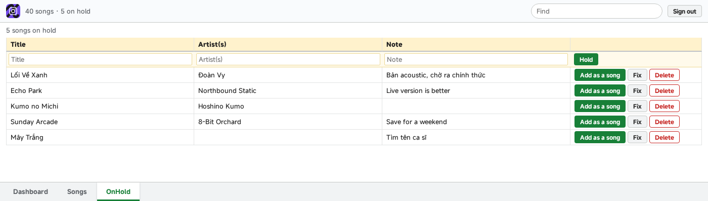
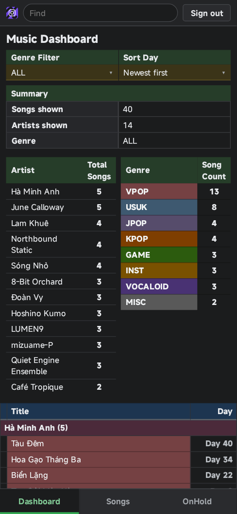
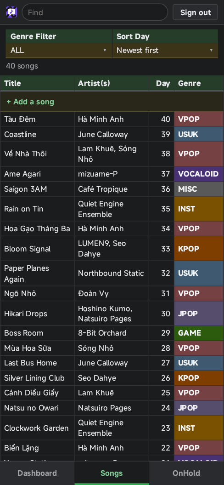

<p align="center">
  
</p>

<h1 align="center">xrninsta</h1>

The song-of-the-day list, kept by a Telegram bot. Send it a song (title, artist, genre, one per
line) and it becomes the next day's; it warns about a song that's already there, keeps an OnHold
list of songs for later, searches by title, artist, genre or "day 26", and shows leaderboards. A
page on the home server looks like the sheet did, with its Dashboard, Songs and OnHold tabs, and
lets you fix or delete anything. The same program also runs a second bot, the Daily Story Bot,
which sends the day's cover image at 2am Sydney time.

Both bots used to be Google Apps Scripts: the song bot bound to a Google Sheet, the cover bot
reading a Google Drive folder. Those scripts are kept in [apps-script/](apps-script/) as the record
of what the bots did. This is the same pair, word for word in Vietnamese, with the songs in an
SQLite file and the covers in a folder on the home server, and nothing at Google. It is one Python
file, [server/xrninsta.py](server/xrninsta.py) (standard library plus `bcrypt`), and a page in
[web/](web/) with no build step.



*The Dashboard, as the sheet had it: the Genre Filter and Sort Day cells, each artist's songs under
their name, and the counts beside them. Every song in these pictures is made up.*

## The song bot

It answers one chat (the `chat` in `bot.json`) and nothing else. Its messages are in Vietnamese, as
the script's were.

- **Adding.** Any message that isn't a command is a song: title, artist(s) and genre on up to three
  lines. With only a title it asks for the artist; without a genre it shows a button for each one
  (VPOP, USUK, JPOP, MISC, KPOP, GAME, INST, VOCALOID; "US-UK", "j pop", "voca" and the like are
  understood). The song takes the next day number. `/add` with the lines after it does the same.
- **What it checks first.** A song that looks like one already in Songs (by title and artist, with
  the script's fuzzy match) gets a warning with that song's day and genre, and "add anyway" or
  "cancel". An artist typed in another spelling of one already there ("Vstra" for "VSTRA") is
  saved in the spelling already used, so leaderboards don't split one artist in two, and the reply
  says so. A song that is also on hold says that too.
- **After adding.** The reply has an Undo button, and a "remove from OnHold" button when the song
  was held. Both find their song by its id and title, so they still work on old messages.
- **OnHold.** `/hold` with title, artist and a note (only the title is needed) puts a song aside. A
  song already held or already in Songs is asked about first.
- **Search.** `/search` by title or artist (fuzzy, Songs and OnHold together, with a match
  percentage), by genre name, or `day 26`. Five results a page, with page buttons that keep
  working for six hours.
- **Stats.** `/stats` gives the count, the newest day, and buttons for the Genre Leaderboard, the
  Artist Leaderboard (top 15), the artist leaderboard for one genre, and the OnHold list, eight a
  page, where each entry can be added as a song or deleted (after a confirmation).
- **The rest.** `/cancel` drops what the bot was waiting for, and a question it asked lapses after
  an hour, so a new song is never taken as the answer to an old one. A mistyped command is
  answered as such rather than added as a song called "/serch". An error in the bot is sent to the
  chat as a crash line and the bot carries on.

## The page



*Songs, with a row opened by a double click. The yellow row under the header adds a song; its Day No
is already the next day.*

The page replaces the sheet, and looks like it. The same tabs along the bottom, the same fills
(green headers, yellow cells to change, pink artist rows, each title in its genre's colour) and the
same columns, full width, with the top rows frozen while the rest scrolls:

- **Dashboard:** Genre Filter and Sort Day, each artist's songs under their name (the artist with
  most songs first), and the Summary, Artist (top 12) and Genre counts beside them. Double-click a
  song to fix it in Songs.
- **Songs:** Title, Artist(s), Day No and Genre, with a genre filter and Sort Day (newest first, or
  oldest first as the sheet had them). The yellow row under the header adds a song; double-click a
  row (double-tap on a phone) to fix or delete it, or press its Fix. Songs the Dashboard can't place
  (an unknown genre, no day) are still listed here so they can be fixed.
- **OnHold:** Title, Artist(s) and Note, with a row to add to, and Add as a song, Fix and Delete.



*OnHold. "Add as a song" moves a held song into Songs in one step.*

One click on a row only picks it out, so reading down a list doesn't open a form in it. **Find**,
at the top right (or `/`, or Ctrl+F), narrows whichever tab is shown: the Dashboard's artists and
its counts, Songs by title or artist, and OnHold by title, artist or note, whatever the accents.
Escape puts a row being fixed back as it was.

A change made on the page while the bot changed the same song (or another tab did) isn't lost: the
save is refused with the song as it is now, and the form keeps what was typed. A banner under the
title bar says when the bot isn't running, can't reach Telegram or isn't hearing its chat ("Bot
off: no token in bot.json", "Bot off: the chat in bot.json isn't a chat id", "Bot: can't reach
Telegram", "Bot: ignored another chat: a message came from chat 4242, but the "chat" in bot.json
is 100", "Bot: two copies running" and so on); with the bot running there is none. The page
follows the device's light or dark setting.

<table>
  <tr>
    <td></td>
    <td></td>
  </tr>
</table>

*On a phone (here in dark mode) the tables fit the screen: the rows wrap, the counts sit above the
Dashboard's artists, the Note column folds under the title, and the rows to add to open from a
button.*

It's at `/xrninsta` on the home server's public address, for the server's owner only, signed in
with the sync password.

## The daily cover

The Daily Story Bot is a second Telegram bot with its own token, and stays a separate bot. It used
to be its own Apps Script ([apps-script/coverbot.gs](apps-script/coverbot.gs)) reading a Google
Drive folder of covers. Each cover is `Day_<n>.png`, Day 263 being 18 Oct 2026. xrninsta runs that
bot too, and keeps the covers on the server, in `~/xrninsta/data/covers`. It doesn't make covers;
they're made elsewhere and copied up.

- At **2am Sydney time**, daylight saving or not, it sends that day's cover to its chat with the
  caption "Day 295's cover". `/sendnow` sends it at once, and `/start` says hello, as before. It
  answers only its own chat.
- It notes the day it last sent. A restart never sends a cover twice, and a server that was off at
  2am sends that day's cover once it's back (never an older one). The night the clocks go forward
  it sends at 3am; the night they go back, once.
- A missing cover is said once in the chat, with its name.
- Covers stay on the server once sent. The script moved the last five to the bin.
- The covers are left out of the server's backups. A year of them is 38 MB, and backups are kept
  for 60 days. Keep the zip they came from.
- It needs time zone data, which Termux's Python lacks; `deploy.sh` installs `tzdata`. Without it
  no cover goes out, and the log and `check --covers` say why.

## How it differs from the scripts

- **The bots ask Telegram for messages** (long polling) instead of Telegram posting to a web app, so
  they need no public address and no webhook key. Each bot keeps its own place in its own updates,
  saved before an update is handled, so one that crashes the bot is skipped rather than added twice.
- **Records have ids, not rows.** An imported song keeps its sheet row as its id, so the buttons on
  the script's old messages (Undo, the OnHold list) still find the right song.
- **The matching is the script's, exactly.** Normalising, the duplicate checks and the search scores
  were run side by side with code.gs on the real list: 57,000 comparisons, none different.
- **One lock** covers every read and write of the store, so the bot and the page never interleave
  (what the script needed LockService for).
- **Covers are sent from disk**, uploaded with the message, where the script handed Telegram a file
  from Drive.

## Signing in, and what the page refuses

- Everything under `/api` needs the owner: the first user in the users file shared with the sync
  services (`~/.config/xrn-sync/users`), by Basic auth or by the shared sign-in cookie with an
  `X-Xrn-Client` header. The page signs in once and keeps the cookie for 30 days.
- Signing out ends that cookie on every server that takes it (xrnhub, xrnloops-sync and
  xrnrule-sync too), through `signed-out.json` beside the users file.
- Ten wrong passwords from one address within 15 minutes lock that address out (429) for the rest
  of the window, and a right one clears only its own name's mistakes.
- Writes from another site's page are refused. Bodies over 64 KB, text past the field limits
  (title 200, artists 300, note 1,000), control characters and lone surrogates get a 400, and every
  change to a song or hold needs `If-Match` with the version it was read at (412 otherwise).

The API, for completeness (all JSON):

| | |
|---|---|
| `GET /health` | `ok`, no login (for monitoring) |
| `POST /session`, `DELETE /session` | sign in with Basic auth and get the cookie; sign out |
| `GET /api/data` | every song and OnHold entry, the genres, their colours and the next day |
| `GET /api/status` | whether each bot is reaching Telegram, and the last cover sent |
| `POST /api/songs` | `{title, artists, genre, day?, fromHold?}`; the day defaults to the next |
| `PUT`, `DELETE /api/songs/<id>` | with `If-Match: "<updated>"` |
| `POST /api/holds` | `{title, artists?, note?}` |
| `PUT`, `DELETE /api/holds/<id>` | with `If-Match: "<updated>"` |

## On the server

It runs on the home server as the runit service `xrninsta`, on port 5239, published at
`/xrninsta` through Tailscale Funnel. Its files:

- `~/xrninsta/xrninsta.py` and `~/xrninsta/web/`: what `deploy.sh` copies up.
- `~/xrninsta/data/xrninsta.sqlite`: the songs, the holds, and each bot's place and state.
- `~/xrninsta/data/covers/`: the covers.
- `~/.config/xrninsta/bot.json`: the bots' tokens and chats, readable only by the owner:
  `{"token": ..., "chat": ..., "covers": {"token": ..., "chat": ...}}`. Never in this repo.
- The log: `$PREFIX/var/log/sv/xrninsta/current`. A bot says each change of state once:
  `bot: ok`, `covers bot: ok`, `covers: ok`, or `webhook` (Telegram still sends to the Apps
  Script), `twice` (another copy is polling with the same token), `nochat`, `badchat` (the chat
  in bot.json isn't a chat id, the number Telegram gives a chat, so it answers no one; said as soon
  as it starts), `otherchat` (a message came from a chat other than bot.json's, until bot.json's
  own chat is heard from again), `unreachable`, `refused`. Every update a bot ignores is logged
  with the chat it came from (`bot: update 812 from chat 4242 ignored: ...`), never with what it
  said, so a wrong chat id in bot.json shows the right one in the log.

`server/deploy.sh [--force] [ssh-host]` (default `homeserver`) installs or updates it. It runs the
tests first, refuses uncommitted changes to `server/xrninsta.py` or `web/` (`--force` sends them
anyway), says which branch and commit it sends, copies the program and its page together, installs
`tzdata`, makes the service the first time and restarts it after, waits for `/health`, publishes
`/xrninsta`, and ends with `check` for each bot. It leaves the songs, the covers and `bot.json`
alone. The service's run script calls `~/.local/bin/sv-guard 5239 ~/xrninsta/xrninsta.py` just
before it starts the program, as every other service's does, so a copy left running by a dead
supervisor is stopped instead of holding the port. The guard comes from the home-server repo
(`phone/install-sv-guard`); without it on the phone, `deploy.sh` makes no service and says so.

The commands, all on the server:

```sh
python ~/xrninsta/xrninsta.py song-bot --config ~/.config/xrninsta/bot.json        # asks for the song bot's token and chat
python ~/xrninsta/xrninsta.py check --config ~/.config/xrninsta/bot.json          # which bot, which chat, where its messages go
python ~/xrninsta/xrninsta.py check --covers --config ~/.config/xrninsta/bot.json --data ~/xrninsta/data   # and how far the covers go
python ~/xrninsta/xrninsta.py webhook-off [--covers] --config ~/.config/xrninsta/bot.json   # take a bot's messages from the Apps Script
python ~/xrninsta/xrninsta.py import <export.xlsx> --data ~/xrninsta/data [--replace]
python ~/xrninsta/xrninsta.py covers <zip or folder> --data ~/xrninsta/data
python ~/xrninsta/xrninsta.py covers-bot --config ~/.config/xrninsta/bot.json      # asks for the cover bot's token and chat
```

## Moving over from the scripts

Both bots have moved (November 2026). The steps are kept here for setting it up again.

### The song bot

1. Install it: `server/deploy.sh`. The page runs, and the bot waits for its token.
2. Give it the bot. The token and chat id are in the Apps Script project's settings, under Script
   properties (`BOT_TOKEN`, `ALLOWED_CHAT_ID`). `song-bot` asks for both, so the token never goes
   on a command line, refuses a chat id that isn't a number, and keeps the cover bot's part of
   bot.json:

   ```sh
   ssh -t homeserver 'python ~/xrninsta/xrninsta.py song-bot --config ~/.config/xrninsta/bot.json'
   ssh homeserver 'SVDIR=$PREFIX/var/service sv restart xrninsta'
   ssh homeserver 'python ~/xrninsta/xrninsta.py check --config ~/.config/xrninsta/bot.json'
   ```

   The bot answers only that chat. `check` names the bot and its chat, and says Telegram still
   sends its messages to the Apps Script. Nothing has moved yet.
3. Download the sheet as .xlsx (File, Download, Microsoft Excel) and import it:

   ```sh
   scp ~/Downloads/<the export>.xlsx homeserver:~/xrninsta/import.xlsx
   ssh homeserver 'python ~/xrninsta/xrninsta.py import ~/xrninsta/import.xlsx --data ~/xrninsta/data && rm ~/xrninsta/import.xlsx'
   ```

   It says how many songs and OnHold entries it read, and how many have a genre the bot doesn't
   know or no day; those are kept, and the Songs tab shows them.
4. Switch: `ssh homeserver 'python ~/xrninsta/xrninsta.py webhook-off --config ~/.config/xrninsta/bot.json'`.
   Telegram stops posting to the script and the bot here takes the messages, those waiting
   included, within a minute. It also sets the bot's command list.
5. In the Apps Script editor, delete the trigger that refreshes the Dashboard every 10 minutes, and
   don't run `setupBot` or `forceSetWebhook` again: either would point Telegram back at the script.

Add songs only through the bot between steps 3 and 4 if you're willing to import again; the import
won't run over songs that are already there without `--replace`.

### The cover bot

1. Deploy (`server/deploy.sh`) so the server has the commands below.
2. Copy the covers. A zip of the Drive folder works as it is, and so does a folder of PNGs:

   ```sh
   scp output_stories.zip homeserver:~/xrninsta/covers.zip
   ssh homeserver 'python ~/xrninsta/xrninsta.py covers ~/xrninsta/covers.zip --data ~/xrninsta/data && rm ~/xrninsta/covers.zip'
   ```

   It says how far the covers go and which are missing. Add more the same way. A cover with a name
   already there replaces it. Anything that isn't a `Day_<n>.png` PNG within Telegram's 10 MB is
   skipped, and the first few skipped are named.
3. Give it the bot. The token and chat are in the cover script's Project Settings, under Script
   properties (`BOT_TOKEN`, `ALLOWED_CHAT_ID`). The command asks for both, so the token never goes
   on a command line, and refuses the song bot's token:

   ```sh
   ssh -t homeserver 'python ~/xrninsta/xrninsta.py covers-bot --config ~/.config/xrninsta/bot.json'
   ssh homeserver 'SVDIR=$PREFIX/var/service sv restart xrninsta'
   ```

   Started after 2am, it takes that day's cover as sent by the script, and starts with tomorrow's.
4. Switch: `ssh homeserver 'python ~/xrninsta/xrninsta.py webhook-off --covers --config ~/.config/xrninsta/bot.json'`.
   `check --covers` (add `--data ~/xrninsta/data` for the covers) shows where its messages go.
5. In the cover script's Triggers, delete the daily trigger for `sendDailyStory` before the next
   2am, or both send that night's cover. Don't run `forceSetWebhook` again.

## Running it on the laptop

Python 3.11 or newer, plus `bcrypt`.

```sh
python3 server/xrninsta.py --port 5239 --data ./data --users <htpasswd file> --config bot.json
```

Open `http://127.0.0.1:5239/xrninsta/` and sign in as the users file's first user. Without a token
in bot.json the page runs and the bot doesn't, and the page says "Bot off". Don't give a laptop
copy a real bot's token while the server's copy runs: Telegram hands each update to one poller,
and both log `twice`.

The page is set in MiSans, the font of every xrn app, served with it (`web/MiSansLatinVF.woff2`).

## Tests

```sh
cd server && python3 -m unittest test_xrninsta
node --test test
```

The first (84 tests) drive both bots against a fake Telegram, import a made-up sheet, add made-up
covers, and use the page's API over HTTP; the second (11) check the page's own arithmetic
(`web/model.js`: the Dashboard's groups and counts, the Songs tab's find and order, the double
click, the error labels). Every song in them is made up; never add real ones, an export of the
sheet, or a real cover, to this repo. `.gitignore` keeps out `*.xlsx`, `*.csv`, `*.zip` and every
PNG but the screenshots.

The screenshots come from a copy of the server run on the laptop with made-up songs and no bot
token, in headless Chromium.

## Files

| | |
|---|---|
| `server/xrninsta.py` | the bots, the store, the importer and the page's server, in one file |
| `server/test_xrninsta.py` | its tests |
| `server/deploy.sh` | installs or updates it on the home server |
| `web/` | the page: `index.html`, `app.js` (the DOM), `model.js` (the arithmetic), `style.css`, the icon, and the font with its note (`web/README.md`) |
| `test/page.test.mjs` | the page's tests |
| `apps-script/code.gs`, `apps-script/coverbot.gs` | the Apps Scripts it replaced |
| `docs/screenshots/` | the pictures above |

## Licence

MIT, in [LICENSE](LICENSE), except the font.

## Credits

MiSans by Xiaomi, used under the MiSans font licence (free for commercial use when the software
notes that it uses MiSans). The font files are not covered by this repository's licence.
https://hyperos.mi.com/font/en/
